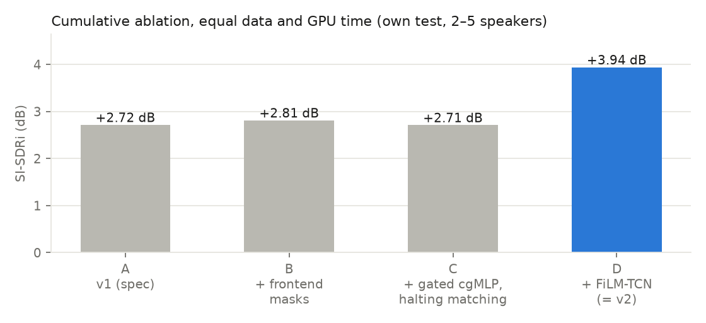
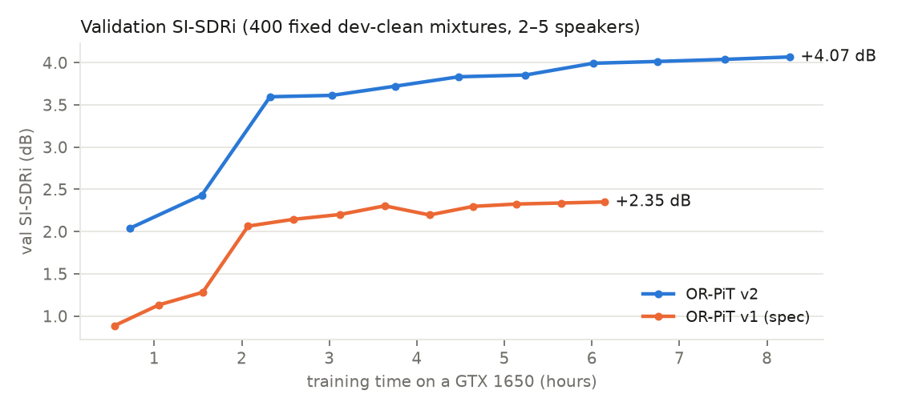
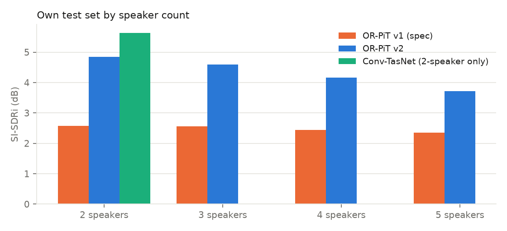
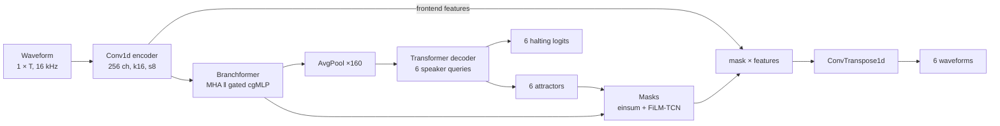

# OR-PiT

**Speaker-count-agnostic single-channel speech separation.** One network takes a noisy recording of
2 to 5 overlapping speakers, returns one waveform per speaker and estimates how many speakers there
are, in a single forward pass.


OR-PiT combines a Branchformer encoder, six learned attractor queries in a Transformer decoder, a
halting classifier per slot and attractor-conditioned masks. Training uses Hungarian permutation-invariant
training on SI-SDR, so the cost of assigning outputs to speakers grows as O(N³) instead of O(N!).
Everything in this repository was trained and evaluated on a single 4 GB GTX 1650.

- **One model for 2–5 speakers.** Six output slots and a halting head replace a separate model per
  speaker count.
- **Measured, not claimed.** A cumulative ablation at equal compute, a Conv-TasNet baseline trained with
  the same data and GPU time, and the official Libri2Mix / Libri3Mix test sets.
- **Reproducible on modest hardware.** On-the-fly mixing, deterministic recipes, mid-epoch resumable
  training, VRAM probing and an epoch planner that fits a schedule into a fixed time budget.

## Contents

- [Results](#results)
- [Architecture](#architecture)
- [Installation](#installation)
- [Data](#data)
- [Training](#training)
- [Evaluation](#evaluation)
- [Inference](#inference)
- [Repository layout](#repository-layout)
- [Limitations and roadmap](#limitations-and-roadmap)
- [Citation and licences](#citation-and-licences)

## Results

All numbers are SI-SDR improvement (SI-SDRi, dB) over the unprocessed mixture, from real runs on a
GTX 1650. Full tables, including every evaluation file used, are in [`results/RESULTS.md`](results/RESULTS.md).

| Model | Params | Train time | Own test, 2–5 spk | 2 spk | 5 spk | Libri2Mix noisy | Libri3Mix noisy | Count acc. |
|---|---|---|---|---|---|---|---|---|
| OR-PiT v1 (original spec) | 5.28 M | 6.1 h | 2.49 | 2.58 | 2.35 | – | – | 25.0 % |
| **OR-PiT v2** | 6.14 M | 8.3 h | **4.33** | 4.85 | 3.72 | 3.11 | 2.69 | 36.2 % |
| Conv-TasNet (2-speaker model) | 5.05 M | 8.3 h | – | 5.63 | – | 3.85 | – | – |

<p align="center">
  
  
</p>
<p align="center">
  
</p>

**Ablation.** Each Revision 2 change was added one at a time with the same data, seed and budget
(6 epochs of 3,000 two-second mixtures): v1 2.72 dB → frontend masks 2.81 → gated cgMLP with
halting-aware matching 2.71 → FiLM-TCN mask refinement **3.94**. The mask refinement is the change that
matters for separation quality; the gated MLP and matching cost mainly help counting.

**Test sets.**
- *Own test*: 1,000 fixed 4 s mixtures of LibriSpeech test-clean (speakers never seen in training),
  2–5 speakers, 30–100 % overlap, WHAM! noise at −5 to 5 dB SNR.
- *LibriMix*: the official Libri2Mix and Libri3Mix test sets (3,000 mixtures each, 16 kHz, min mode),
  rebuilt from the published metadata.

**Reading the numbers.**
- The 2-speaker Conv-TasNet specialist beats OR-PiT by 0.7–0.8 dB on 2-speaker data. OR-PiT's advantage
  is one model for every count.
- Oracle matching lets OR-PiT pick the best N of its six outputs. Scoring only the outputs the halting
  head keeps (missed speakers count as 0 dB) gives 3.57 dB on the own test set.
- Speaker counting is weak and depends on loudness: LibriMix mixtures are ~5 dB quieter than the training
  mixtures, and the head under-counts on them. Rescaling inputs to −19 dBFS barely changes separation
  (Libri2Mix 3.23, Libri3Mix 2.89) but flips the bias to over-counting.
- For scale, the LibriMix paper reports 13.5 dB for Conv-TasNet on noisy Libri2Mix with a far larger
  compute budget. Both models here are compute-limited.

**Speed** (fp32, one forward pass, GTX 1650): OR-PiT processes a 4 s clip in 272 ms (15× real time,
1.0 GB VRAM); an 8 s clip fills the 4 GB card because self-attention runs over every frame, so long
inputs are processed in overlapping chunks. Conv-TasNet stays at 13–16× real time up to 16 s.

## Architecture

The full specification, including Revision 2, is in [`ARCHITECTURE.md`](ARCHITECTURE.md).



| Stage | v1 (original spec) | v2 (Revision 2) |
|---|---|---|
| Encoder | Conv1d(1→256, k16, s8) + one Branchformer block (4-head MHA ‖ cgMLP) | cgMLP with a convolutional spatial gating unit (R2.2) |
| Attractors | AvgPool(160) → TransformerDecoder (3 layers, 8 heads), 6 learned queries, linear halting head | unchanged |
| Masks | 0.1 + 0.9 · σ(einsum(attractor, Y)) applied to Y | applied to the frontend features (R2.3); logits refined by a FiLM-conditioned TCN (R2.4) |
| Loss | Hungarian PIT on SI-SDR + BCE halting | matching cost SI-SDR + 2 · log σ(logit) (R2.5) |

Both presets are built from the same modules: `SeparationNetwork()` is v1, `build_model({"model":
{"preset": "v2"}})` is v2, and `{"arch": "convtasnet"}` builds the baseline.

## Installation

Python 3.10–3.12 and PyTorch 2.6. The setup scripts create a virtual environment, install the CUDA
build of PyTorch and the pinned requirements.

```bash
# Linux (CPU by default; ORPIT_CUDA=cu124 for an NVIDIA GPU)
ORPIT_CUDA=cu124 ./setup_env.sh
source .venv/bin/activate
```

```bat
:: Windows + NVIDIA GPU (venv in .venv\ unless ORPIT_VENV is set)
setup_env.bat
.venv\Scripts\activate
```

Or install manually: `pip install torch==2.6.0 --index-url https://download.pytorch.org/whl/cu124`
followed by `pip install -r requirements.txt`. `pip install -e ".[dev]"` adds pytest and ruff.

Check the install with the synthetic smoke test (no downloads needed):

```bash
python scripts/make_synthetic.py
python -m pytest
python -m orpit.train --config configs/smoke.yaml --run_name smoke
```

## Data

Audio lives under one root, `data/audio` by default. Point `ORPIT_AUDIO_ROOT` at another folder
(for example a large external drive) to keep it elsewhere; checkpoints store the path, and the
variable relocates it.

| Dataset | Use | Size | Licence |
|---|---|---|---|
| LibriSpeech train-clean-100 + train-clean-360 | training speech (1,172 speakers, 462 h) | 6.3 + 23 GB | CC BY 4.0 |
| LibriSpeech dev-clean / test-clean | validation / test speech | 0.3 + 0.3 GB | CC BY 4.0 |
| WHAM! noise (subset: 8,000 tr, 500 cv, 500 tt files, mono FLAC) | additive noise | ~1.6 GB | CC BY-NC 4.0 |
| LibriMix metadata + the WHAM! tt files it references | Libri2Mix / Libri3Mix test sets | small | MIT |

```bash
export ORPIT_AUDIO_ROOT=data/audio                     # or any other folder
python scripts/download_librispeech.py --root $ORPIT_AUDIO_ROOT \
    --subsets dev-clean test-clean train-clean-100 train-clean-360
python scripts/download_wham_subset.py --root $ORPIT_AUDIO_ROOT --n_tr 8000 --n_cv 500 --n_tt 500

# indices, fixed val/test recipes, room impulse responses, sanity checks
python scripts/build_index.py --audio_root $ORPIT_AUDIO_ROOT
python scripts/build_index.py --audio_root $ORPIT_AUDIO_ROOT --librimix_lengths train-clean-100 train-clean-360
python scripts/make_mixtures.py --config configs/gtx1650.yaml --split val test
python scripts/make_rir_bank.py --out $ORPIT_AUDIO_ROOT/rir_banks/train.npz --rooms 600 --seed 1
python scripts/make_rir_bank.py --out $ORPIT_AUDIO_ROOT/rir_banks/eval.npz --rooms 150 --seed 2
python scripts/sanity_check_data.py --config configs/gtx1650.yaml

# official LibriMix test sets
python scripts/get_librimix_metadata.py
python scripts/download_wham_librimix.py --root $ORPIT_AUDIO_ROOT
python scripts/make_librimix_test.py --root $ORPIT_AUDIO_ROOT --n_src 2 3
```

On Windows without Python, `scripts/windows/download_librispeech.ps1 -Root <folder>` downloads and
MD5-verifies LibriSpeech with built-in tools.

**Mixing.** Training mixtures are generated on the fly from small JSON recipes (`orpit/mixing.py`),
deterministic per (seed, epoch, index): distinct speakers, Gamma-distributed onset gaps, active-speech
crops, sources at −25 dBFS ± 2.5 dB, WHAM! noise at the target SNR, optional reverb from a
pyroomacoustics RIR bank, peak ≤ 0.9. Train, validation and test use disjoint LibriSpeech speakers and
disjoint WHAM! splits. The curriculum (`orpit/curriculum.py`) is set per config.

## Training

```bash
python -m orpit.train --config configs/v2/final_orpit_v2.yaml --run_name final_orpit_v2
python -m orpit.train --config configs/v2/final_convtasnet.yaml --run_name final_convtasnet
```

Runs resume automatically from `runs/<run_name>/last.pt`, including mid-epoch. Any config value can be
overridden from the command line, for example `--set train.batch_size=1 audio.segment_sec=3.0`.

| Config | Purpose |
|---|---|
| `configs/default.yaml` | base recipe: data paths, mixing, curriculum, optimiser |
| `configs/gtx1650.yaml` | 4 GB GPU profile (fp32, batch 2 × 8 accumulation) |
| `configs/gtx1650_budget.yaml` | the 6.1 h v1 run of the original spec |
| `configs/v2/ablation_base.yaml`, `abl_A…D` | the cumulative ablation |
| `configs/v2/final_orpit_v2.yaml` | final OR-PiT v2 run (train-clean-100 + 360, 3 s segments, warmup-cosine) |
| `configs/v2/final_convtasnet.yaml` | Conv-TasNet baseline with the same data and budget |
| `configs/smoke.yaml` | synthetic smoke test |

Each run writes `config.yaml`, `train_log.csv` (loss, SI-SDR, learning rate, gradient norm, seconds per
batch, peak VRAM), `metrics.csv` (validation per epoch and per speaker count), `last.pt`, `best.pt` and
the latest epoch checkpoints.

**Fitting a time budget.** `scripts/vram_probe.py` measures peak memory and step time for a config, and
`scripts/plan_epochs.py` turns that into the number of epochs that lets a cosine schedule finish inside
a given number of minutes (`train.max_minutes` is a hard stop).

## Evaluation

```bash
CK=runs/final_orpit_v2/best.pt
python -m orpit.evaluate --checkpoint $CK --split val --calibrate --name eval_val_cal   # choose τ on validation
python -m orpit.evaluate --checkpoint $CK --split test --threshold auto --name eval_test_cal
python -m orpit.evaluate --checkpoint $CK --threshold auto --name eval_libri2mix_noisy \
    --folder $ORPIT_AUDIO_ROOT/LibriMix/Libri2Mix/wav16k/min/test --mix_dir mix_both
python scripts/benchmark_speed.py --checkpoint $CK
python scripts/make_results.py        # results/RESULTS.md and results/results.json
python scripts/make_figures.py        # results/figures/*.png
python scripts/make_demos.py --orpit $CK --baseline runs/final_convtasnet/best.pt \
    --librimix $ORPIT_AUDIO_ROOT/LibriMix --input_rms_db -19 --eval_suffix _norm
```

Metrics per mixture and per speaker count: SI-SDR, SI-SDRi with oracle Hungarian matching, SI-SDRi using
only the slots the halting head keeps, exact count accuracy and the count confusion matrix. PESQ and
STOI are available with `--pesq --stoi` (`pip install pesq pystoi`). `--input_rms_db -19` rescales
inputs to the training level.

## Inference

```bash
python -m orpit.inference --checkpoint runs/final_orpit_v2/best.pt --input_mix mixture.wav \
    --output_dir separated --threshold auto
```

Writes `speaker_1.wav … speaker_N.wav` (N chosen by the halting head, most confident first) and
`separation.json` with every slot probability. Inputs are resampled to 16 kHz, rescaled to −19 dBFS and
processed in overlapping chunks when longer than `--chunk_sec` (8 s); chunk outputs are aligned by
Hungarian matching on the overlap. `--save_all` writes all six slots.

## Repository layout

```
OR-Pit/
├── ARCHITECTURE.md          model specification (v1 and Revision 2)
├── orpit/                   the package
│   ├── encoder.py           Conv1d frontend + Branchformer (gated cgMLP)
│   ├── attractor.py         pooled Transformer-decoder attractors + halting head
│   ├── separator.py         attractor-conditioned masks, FiLM-TCN refinement, decoder
│   ├── model.py             SeparationNetwork, presets V1/V2, build_model
│   ├── baselines/           Conv-TasNet
│   ├── loss.py              SI-SDR, Hungarian PIT, halting loss
│   ├── metrics.py           SI-SDRi, counting metrics, PESQ/STOI hooks
│   ├── mixing.py            recipe sampling and rendering
│   ├── curriculum.py        mixing curriculum
│   ├── data.py              datasets (on-the-fly, fixed recipes, LibriMix folders), sampler
│   ├── config.py            YAML configs with inheritance and CLI overrides
│   └── train.py · evaluate.py · inference.py
├── configs/                 training and evaluation configs
├── scripts/                 data download and preparation, probing, results, figures, demos
├── tests/                   pytest suite (27 tests, CPU)
└── results/                 RESULTS.md, results.json, figures/
```

## Limitations and roadmap

- **Compute.** 8.3 h on a GTX 1650 that throttles to 300 MHz is a small budget; published systems train
  for far longer on much larger GPUs.
- **Counting.** Exact count accuracy is 36 % and the halting head is sensitive to input level. Gain
  augmentation and a count head that uses attractor similarity are the next steps.
- **Length.** Full-resolution self-attention limits single-pass inputs to about 8 s on 4 GB; chunked
  self-attention (dual-path style) would remove the limit.
- **Licence.** WHAM! noise is non-commercial, so models trained with it should be treated as
  non-commercial too.

## Citation and licences

```bibtex
@misc{orpit2026,
  title  = {{OR-PiT}: Speaker-Count-Agnostic Speech Separation with Branchformer Attractors},
  author = {Audio-speech-separation contributors},
  year   = {2026},
  note   = {https://github.com/bibrocks1/Audio-speech-separation}
}
```

Code is released under the [MIT License](LICENSE). Datasets keep their own licences: LibriSpeech
(CC BY 4.0), WHAM! noise (CC BY-NC 4.0) and the LibriMix metadata (MIT).

**References.** Panayotov et al., *LibriSpeech*, ICASSP 2015 · Wichern et al., *WHAM!*, Interspeech 2019 ·
Cosentino et al., *LibriMix*, arXiv:2005.11262 · Luo and Mesgarani, *Conv-TasNet*, IEEE/ACM TASLP 2019 ·
Peng et al., *Branchformer*, ICML 2022 · Carion et al., *DETR*, ECCV 2020 (set matching) ·
Perez et al., *FiLM*, AAAI 2018.
